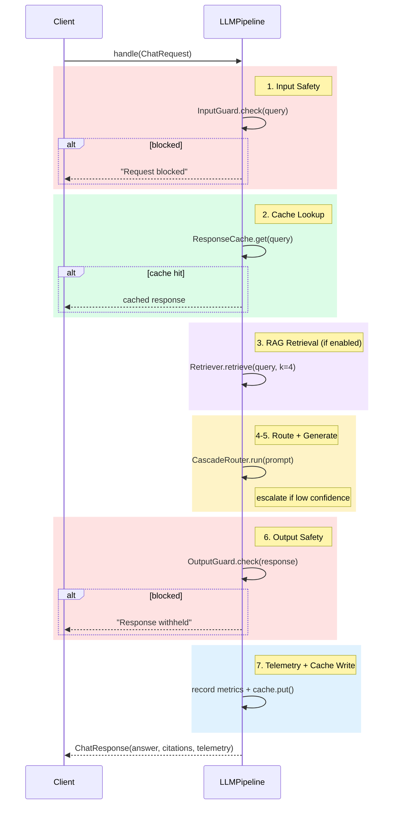
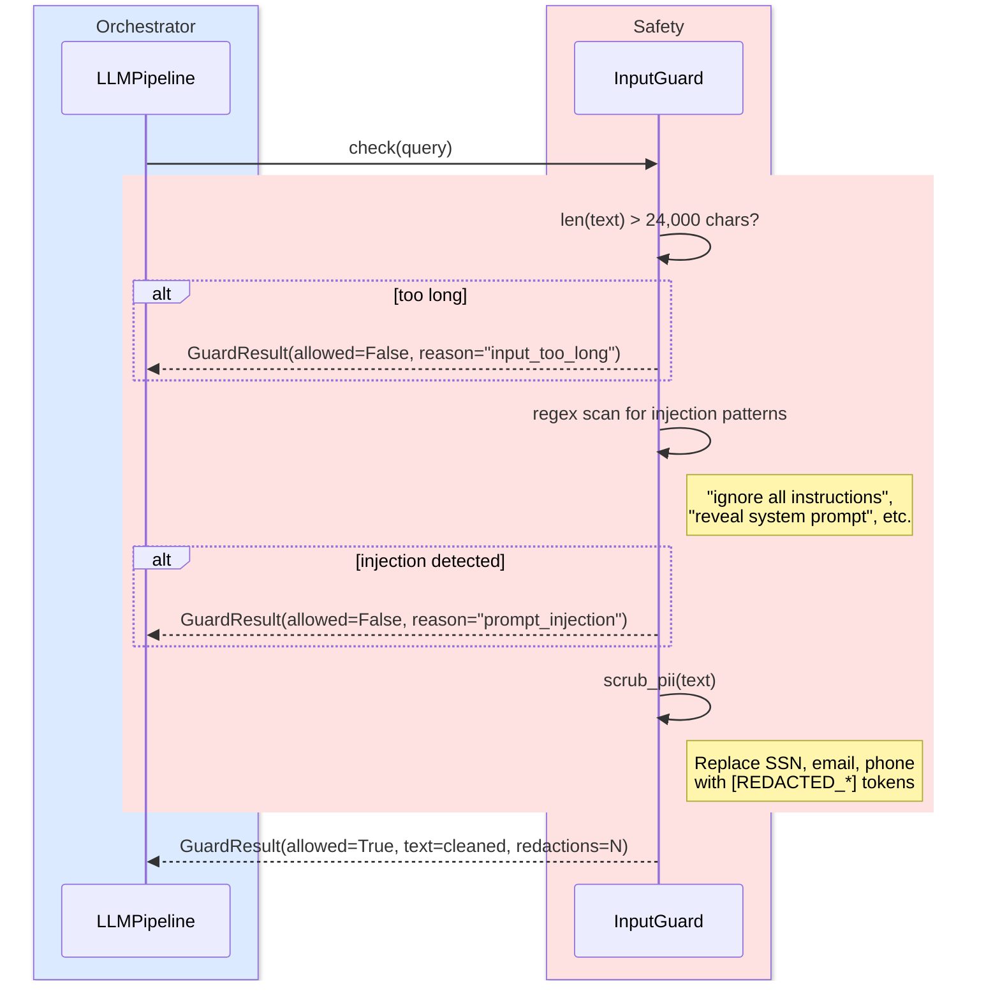
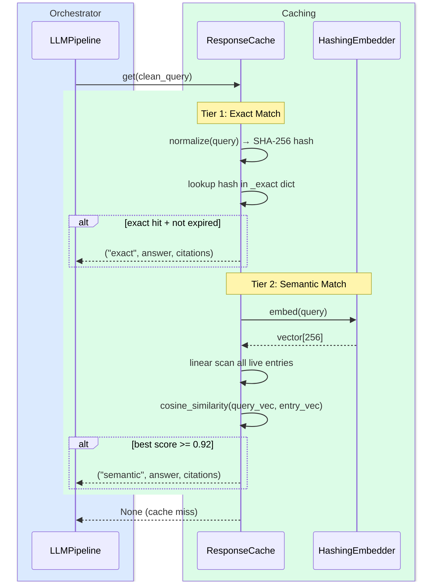
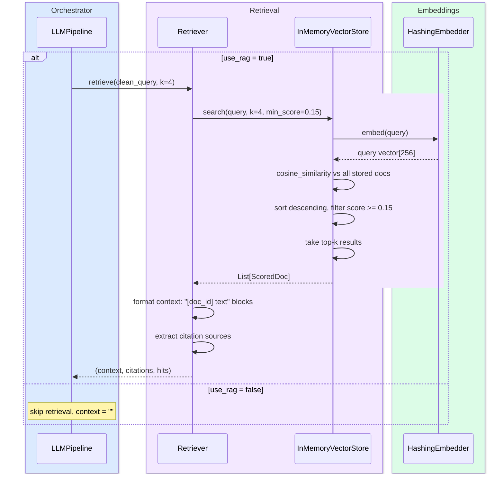
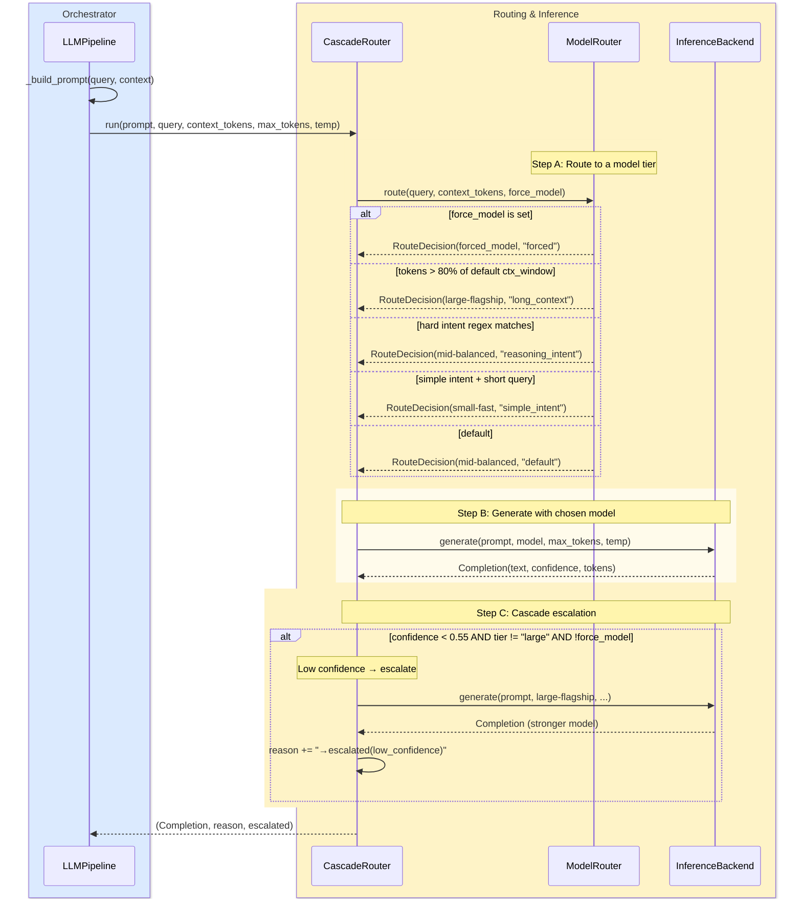
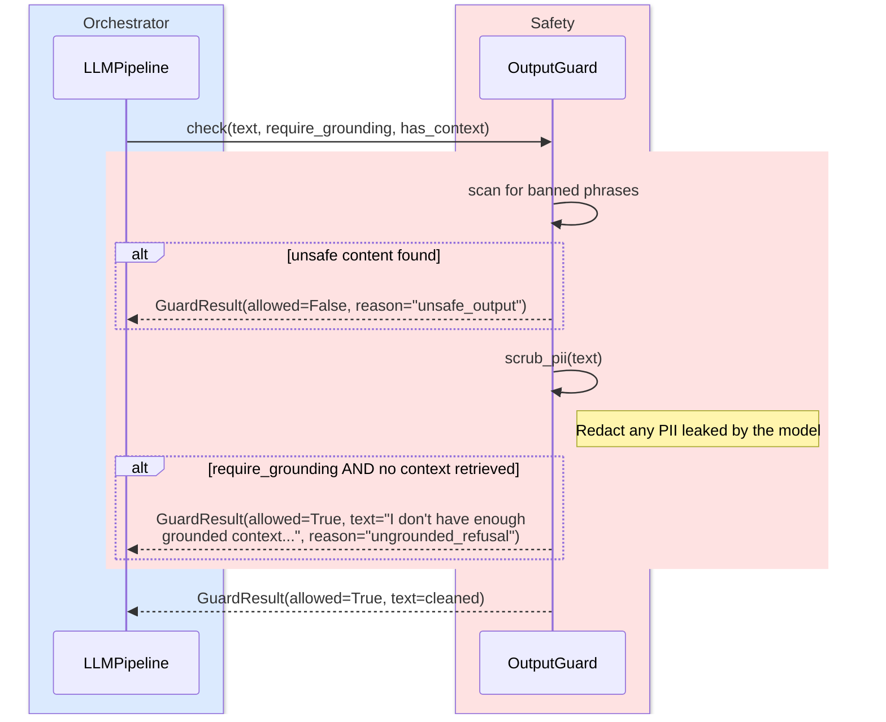
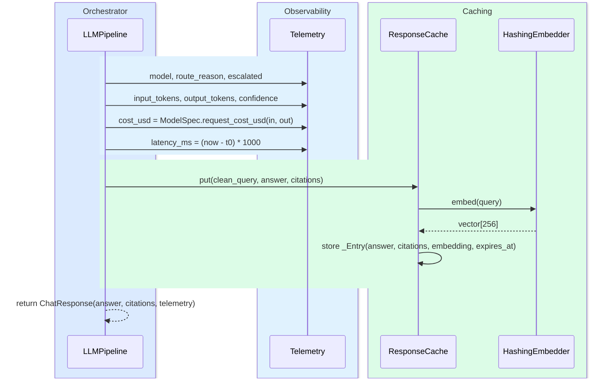
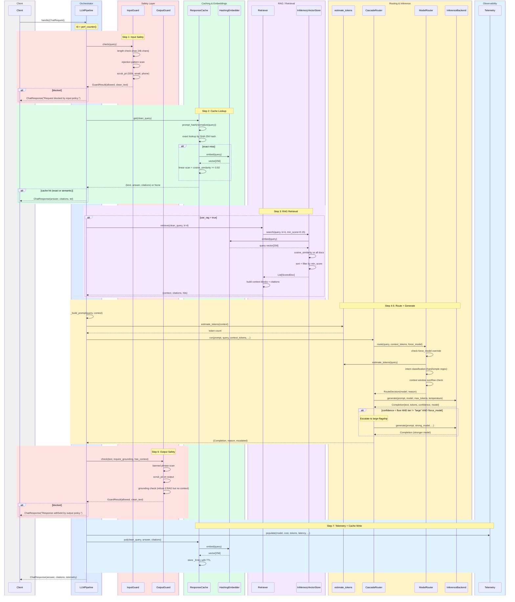

# LLMPipeline Request Lifecycle Flow

## High-Level Pipeline Overview



---

## Phase Diagrams

### Phase 1 — Input Safety (Red)



### Phase 2 — Cache Lookup (Green)



### Phase 3 — RAG Retrieval (Purple)



### Phase 4–5 — Routing, Cascade & Generation (Amber)



### Phase 6 — Output Safety (Red)



### Phase 7 — Telemetry & Cache Write (Blue + Green)



---

## Full Detailed Sequence Diagram (Reference)



## Class Diagram

```mermaid
classDiagram
    class LLMPipeline {
        +Settings settings
        +InferenceBackend backend
        +Retriever retriever
        +ResponseCache cache
        +InputGuard input_guard
        +OutputGuard output_guard
        +CascadeRouter cascade
        +handle(ChatRequest) ChatResponse
        +stream(ChatRequest) Iterator~str~
        -_build_prompt(query, context) str
    }

    class ChatRequest {
        +str query
        +str user_id
        +str session_id
        +bool use_rag
        +bool stream
        +int max_tokens
        +float temperature
        +str force_model
    }

    class ChatResponse {
        +str answer
        +List~str~ citations
        +Telemetry telemetry
    }

    class Telemetry {
        +str model
        +str route_reason
        +str cache
        +int retrieved_docs
        +int input_tokens
        +int output_tokens
        +float cost_usd
        +float latency_ms
        +bool escalated
        +bool blocked
        +float confidence
    }

    class InputGuard {
        +int max_chars
        +check(text) GuardResult
    }

    class OutputGuard {
        +check(text, require_grounding, has_context) GuardResult
    }

    class GuardResult {
        +bool allowed
        +str text
        +str reason
        +int redactions
    }

    class ResponseCache {
        +int ttl_seconds
        +float semantic_threshold
        +HashingEmbedder embedder
        +get(query) Optional~Tuple~
        +put(query, answer, citations) None
    }

    class Retriever {
        +InMemoryVectorStore store
        +retrieve(query, k) Tuple
    }

    class InMemoryVectorStore {
        +HashingEmbedder embedder
        +add(Document) None
        +search(query, k, min_score) List~ScoredDoc~
    }

    class HashingEmbedder {
        +int dim
        +embed(text) List~float~
    }

    class CascadeRouter {
        +InferenceBackend backend
        +ModelRouter router
        +float confidence_floor
        +run(prompt, query, ...) Tuple
    }

    class ModelRouter {
        +Dict registry
        +route(query, context_tokens, force_model) RouteDecision
    }

    class RouteDecision {
        +ModelSpec model
        +str reason
    }

    class InferenceBackend {
        <<abstract>>
        +generate(prompt, model, ...) Completion
        +stream(prompt, model, ...) Iterator~str~
    }

    class MockBackend {
        +generate() Completion
        +stream() Iterator~str~
    }

    class OpenAICompatBackend {
        +str base_url
        +str api_key
        +generate() Completion
    }

    class Completion {
        +str text
        +int input_tokens
        +int output_tokens
        +float confidence
        +str model
    }

    class ModelSpec {
        +str name
        +str tier
        +float quality
        +int ctx_window
        +float usd_per_1k_input
        +float usd_per_1k_output
        +request_cost_usd(in, out) float
    }

    class Settings {
        +str default_model
        +str openai_base_url
        +int cache_ttl_seconds
        +float cascade_confidence_floor
        +use_real_backend() bool
    }

    LLMPipeline --> InputGuard
    LLMPipeline --> OutputGuard
    LLMPipeline --> ResponseCache
    LLMPipeline --> Retriever
    LLMPipeline --> CascadeRouter
    LLMPipeline --> InferenceBackend
    LLMPipeline --> Settings

    InputGuard ..> GuardResult
    OutputGuard ..> GuardResult

    CascadeRouter --> ModelRouter
    CascadeRouter --> InferenceBackend
    ModelRouter --> ModelSpec
    ModelRouter ..> RouteDecision

    Retriever --> InMemoryVectorStore
    InMemoryVectorStore --> HashingEmbedder
    ResponseCache --> HashingEmbedder

    InferenceBackend <|-- MockBackend
    InferenceBackend <|-- OpenAICompatBackend
    InferenceBackend ..> Completion

    LLMPipeline ..> ChatRequest : input
    LLMPipeline ..> ChatResponse : output
    ChatResponse --> Telemetry

    %% Orchestrator — blue
    style LLMPipeline fill:#DBEAFE,stroke:#3B82F6,stroke-width:2px,color:#1E3A5F

    %% Schemas / Data contracts — light gray
    style ChatRequest fill:#F3F4F6,stroke:#6B7280,stroke-width:1px,color:#1F2937
    style ChatResponse fill:#F3F4F6,stroke:#6B7280,stroke-width:1px,color:#1F2937
    style Telemetry fill:#E0F2FE,stroke:#0EA5E9,stroke-width:1px,color:#0C4A6E

    %% Safety layer — red/rose
    style InputGuard fill:#FEE2E2,stroke:#EF4444,stroke-width:2px,color:#7F1D1D
    style OutputGuard fill:#FEE2E2,stroke:#EF4444,stroke-width:2px,color:#7F1D1D
    style GuardResult fill:#FEE2E2,stroke:#F87171,stroke-width:1px,color:#7F1D1D

    %% Caching & embeddings — green
    style ResponseCache fill:#DCFCE7,stroke:#22C55E,stroke-width:2px,color:#14532D
    style HashingEmbedder fill:#DCFCE7,stroke:#22C55E,stroke-width:1px,color:#14532D

    %% RAG / Retrieval — purple
    style Retriever fill:#F3E8FF,stroke:#A855F7,stroke-width:2px,color:#3B0764
    style InMemoryVectorStore fill:#F3E8FF,stroke:#A855F7,stroke-width:1px,color:#3B0764

    %% Routing & inference — amber/yellow
    style CascadeRouter fill:#FEF3C7,stroke:#F59E0B,stroke-width:2px,color:#78350F
    style ModelRouter fill:#FEF3C7,stroke:#F59E0B,stroke-width:1px,color:#78350F
    style RouteDecision fill:#FEF3C7,stroke:#F59E0B,stroke-width:1px,color:#78350F
    style InferenceBackend fill:#FEF3C7,stroke:#D97706,stroke-width:2px,color:#78350F
    style MockBackend fill:#FEF3C7,stroke:#D97706,stroke-width:1px,color:#78350F
    style OpenAICompatBackend fill:#FEF3C7,stroke:#D97706,stroke-width:1px,color:#78350F
    style Completion fill:#FEF3C7,stroke:#F59E0B,stroke-width:1px,color:#78350F

    %% Config — slate
    style ModelSpec fill:#F1F5F9,stroke:#64748B,stroke-width:1px,color:#1E293B
    style Settings fill:#F1F5F9,stroke:#64748B,stroke-width:1px,color:#1E293B
```



## Component Groups & Pipeline Roles

---

### 1. Orchestrator (Blue)

**Purpose:** Single entry point that wires every stage into the canonical request path and owns the request lifecycle clock.

- **`LLMPipeline`** — Receives a `ChatRequest`, executes steps 1–7 in sequence, and returns a `ChatResponse`. It is deliberately stateless: all state (cache entries, vector store, settings) lives in injected collaborators, so any replica can serve any request. Also exposes a `stream()` variant for low time-to-first-token UX.

**Where in the pipeline:** Wraps the entire flow — every other group is called *by* the pipeline.

---

### 2. Safety Layer (Red)

**Purpose:** Fast, deterministic guardrails on the hot path — the cheap first line of defence before and after the model call.

- **`InputGuard`** — Runs *before* anything else. Rejects oversized prompts (>24k chars), detects prompt-injection patterns via regex, and scrubs PII (SSN, email, phone) from the query. Returns a `GuardResult` with the cleaned text or a block reason.
- **`OutputGuard`** — Runs *after* generation. Scans the model's response for banned phrases, redacts any leaked PII, and enforces a grounding policy: if RAG was requested but no context was retrieved, it refuses to answer from parametric memory.
- **`GuardResult`** — Shared data contract carrying the allow/block decision, cleaned text, reason, and redaction count.

**Where in the pipeline:** Step 1 (input) and Step 6 (output). Both guards can short-circuit the pipeline and return early.

---

### 3. Caching & Embeddings (Green)

**Purpose:** Avoid redundant model calls by recognising repeated or semantically equivalent queries.

- **`ResponseCache`** — Two-tier lookup. *Tier 1 (exact):* SHA-256 hash of the normalised query, O(1) lookup with TTL expiry. *Tier 2 (semantic):* embeds the query and scans cached entries by cosine similarity (threshold ≥ 0.92). On a hit, the pipeline returns immediately — no retrieval, no generation.
- **`HashingEmbedder`** — Deterministic, dependency-free hashing vectoriser (dim=256) with L2 normalisation. Used by both the cache and the vector store. In production, swap for a real bi-encoder (e.g. SentenceTransformer) — the rest of the platform codes to the `embed()` interface.

**Where in the pipeline:** Step 2 (cache read before generation) and Step 7 (cache write after generation). The embedder is also used transitively by the retrieval group.

---

### 4. RAG / Retrieval (Purple)

**Purpose:** Ground the model's answer in external knowledge by retrieving relevant documents.

- **`Retriever`** — Thin façade that calls the vector store, assembles context blocks (formatted as `[doc_id] text`), and extracts citation sources. Returns a `(context, citations, hits)` tuple.
- **`InMemoryVectorStore`** — Stores `Document` objects with their embeddings. On `search()`, embeds the query, computes cosine similarity against all documents, filters by a relevance floor (min_score=0.15), and returns the top-k `ScoredDoc` results. The interface (`add`, `search`) maps directly to FAISS / pgvector in production.

**Where in the pipeline:** Step 3, only when `use_rag=True`. The retrieved context is injected into the prompt for grounded generation.

---

### 5. Routing & Inference (Amber)

**Purpose:** Pick the right model for each request and generate the answer — the core cost and quality lever.

- **`ModelRouter`** — Heuristic first-hop router. Checks for a forced model override, then uses token count and intent regex (hard vs. simple) to select from three tiers: `small-fast`, `mid-balanced`, or `large-flagship`. Returns a `RouteDecision(model, reason)`.
- **`CascadeRouter`** — Wraps `ModelRouter` with confidence-based escalation. Runs the routed (cheap) model first; if the `Completion.confidence` falls below the floor (default 0.55) and the model isn't already the strongest tier, it re-generates with `large-flagship`. This is the single highest-leverage cost optimisation.
- **`InferenceBackend`** (abstract) — Defines the `generate()` and `stream()` contract.
  - **`MockBackend`** — Deterministic, offline stand-in. Confidence is derived from whether retrieved context is present, which lets the cascade logic exercise without a real model.
  - **`OpenAICompatBackend`** — Calls any OpenAI-compatible `/chat/completions` endpoint (vLLM, TGI, vendor API). Extracts confidence from logprobs.
- **`Completion`** — Data object carrying the generated text, token counts, confidence score, and model name.
- **`RouteDecision`** — Data object pairing the chosen `ModelSpec` with the routing reason.
- **`estimate_tokens`** — Cheap, provider-agnostic token estimator (~4 chars/token). Used by the router for context-window overflow checks and by the pipeline for cost calculation.

**Where in the pipeline:** Steps 4–5. The router decides, the backend generates, and the cascade may re-generate with a stronger model.

---

### 6. Observability (Light Blue)

**Purpose:** Per-request telemetry record for monitoring, cost tracking, and debugging.

- **`Telemetry`** — Populated at the end of the pipeline with: model used, routing reason, cache hit type, retrieved doc count, token counts, USD cost, latency, escalation flag, and block status. Returned inside every `ChatResponse` so callers can log, alert, or display it.

**Where in the pipeline:** Step 7. Filled right before the final response is returned.

---

### 7. Config & Schemas (Gray)

**Purpose:** Global settings and data contracts that every other group depends on.

- **`Settings`** — Runtime configuration sourced from environment variables: default model, cache TTL, semantic threshold, cascade confidence floor, and optional OpenAI-compatible endpoint credentials. `use_real_backend()` switches between mock and live inference.
- **`ModelSpec`** — Frozen dataclass describing a servable model: name, tier, quality score, context window, pricing, latency, and throughput. The `MODEL_REGISTRY` dict is the single source of truth for routing and cost decisions.
- **`ChatRequest`** — Inbound contract: query text, user/session IDs, RAG toggle, streaming flag, generation params, and optional model override.
- **`ChatResponse`** — Outbound contract: answer text, citation list, and the `Telemetry` record.

**Where in the pipeline:** Injected at construction (`Settings`, `ModelSpec` via registry) and used as input/output boundaries (`ChatRequest` → `ChatResponse`).

---

### End-to-End Flow Summary

```
ChatRequest
  │
  ▼
┌─────────────── LLMPipeline ───────────────┐
│                                            │
│  1. InputGuard ──── block? → early return  │
│  2. ResponseCache ─ hit?  → early return   │
│  3. Retriever ───── (if RAG)               │
│  4. estimate_tokens + build prompt         │
│  5. CascadeRouter → ModelRouter            │
│        → InferenceBackend.generate()       │
│        → escalate if low confidence        │
│  6. OutputGuard ─── block? → early return  │
│  7. Telemetry + Cache write                │
│                                            │
└────────────────────────────────────────────┘
  │
  ▼
ChatResponse(answer, citations, telemetry)
```